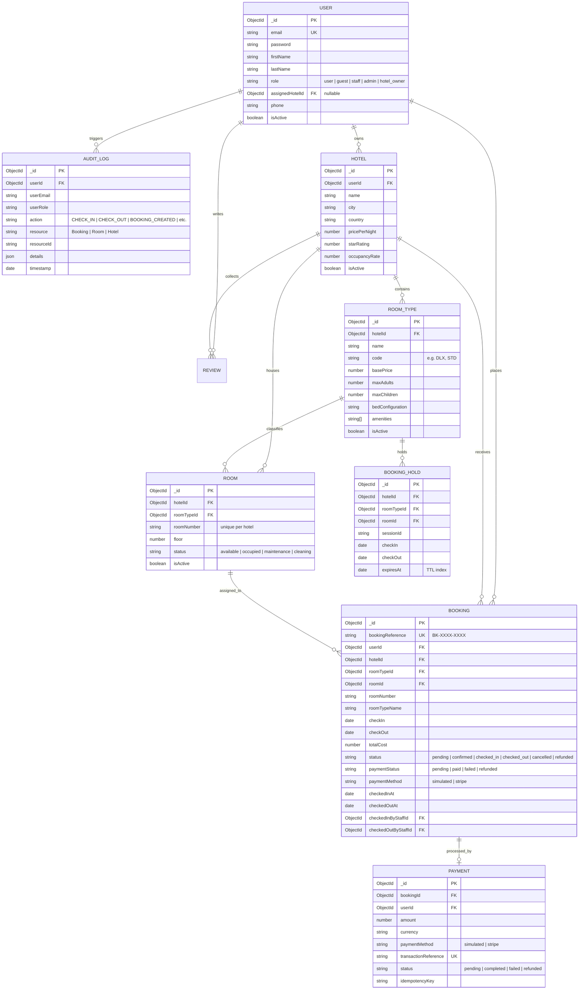

# Hotel Booking Management and Operations System — System Architecture & Design

<!-- Technical Architecture Document — ALGIONS AI LABS Assessment -->

## 1. Executive Summary & Transformation Scope

This document details the architectural design and structural improvements transforming the initial hotel discovery marketplace into a complete, enterprise-grade **Hotel Booking Management and Operations System**.

The system preserves the existing MERN (MongoDB, Express, React, Node.js) + TypeScript architecture while introducing:
- **Three-Tier Multi-Role Authorization**: Guest, Staff, Admin, and Hotel Owner.
- **Physical Room Inventory Engine**: `RoomType`, `Room`, `RoomRate`, and `BookingHold` models ensuring granular inventory control.
- **Concurrency-Safe Reservation Pipeline**: Eliminates double-booking hazards via atomic room allocation and sequential slot verification.
- **Front-Desk Operational Suite**: Real-time room status rack (Available, Occupied, Maintenance, Cleaning), guest check-in/check-out workflow, and search.
- **Offline / Simulated Payment Engine**: Zero-dependency local demonstration without requiring live Stripe credentials.
- **Persistent Compliance Audit Trail**: Every status change, room mutation, check-in, and cancellation is captured in an append-only `AuditLog`.

---

## 2. Technology Stack & Architectural Decisions

| Layer | Technologies | Architectural Role |
|-------|--------------|-------------------|
| **Frontend** | React 18, Vite 7.1, TypeScript 5, Tailwind CSS, Radix/shadcn-style UI, React Query v3, React Router v6 | Single-Page Application (SPA) with role-guarded routes (`AdminRoute`, `StaffRoute`), real-time operational tables, optimistic UI updates, and query invalidation. |
| **Backend** | Node.js, Express 4.18, TypeScript 5.2, Helmet, Compression, Morgan, Express Rate Limit, Cookie Parser | Modular RESTful API structured into resource controllers, RBAC middlewares, and centralized audit logging. |
| **Database** | MongoDB 6+, Mongoose 8.0 ODM | Document store using typed Mongoose schemas, compound unique indexes (`hotelId` + `roomNumber`), and TTL indexes for hold expiration. |
| **Auth & Security** | JWT (HTTP-only cookies + Bearer token fallback), bcryptjs (salt rounds = 10), Express Validator | Role-based authorization enforced strictly server-side; guest isolation ensures users cannot inspect or mutate foreign bookings. |
| **Payments** | Dual Mode: Stripe Test Mode (when `STRIPE_API_KEY` present) + Simulated Local Payment (graceful zero-dependency fallback) | Seamless local operation without paid external accounts. |
| **API Docs & Monitoring** | Swagger UI (`/api-docs`), Express Health Check (`/api/health`), Morgan Logging | OpenAPI 3.0 specification and operational telemetry. |

### Architectural Decision Records (ADR)

- **ADR-001: Preserve MongoDB/Mongoose vs Migrating to PostgreSQL/Prisma**
  - *Context*: Requirements allow either keeping MERN or migrating.
  - *Decision*: Maintain MongoDB + Mongoose.
  - *Rationale*: Avoids breaking hundreds of existing React Query consumers, models, and aggregations. Compound unique indexes and atomic query filters satisfy all assessment concurrency requirements cleanly without introducing migration risk.
- **ADR-002: Dual Payment Engine (Stripe + Simulated)**
  - *Context*: Stripe keys may not be available or network-isolated during evaluation.
  - *Decision*: Graceful degradation. When Stripe API key is absent or contains `"placeholder"`, the system returns `isSimulated: true`, bypasses Stripe Elements, and records a simulated payment reference (`SIM-...`).
- **ADR-003: Room Status Lifecycle State Machine**
  - *Context*: Front desk staff need to track housekeeping and maintenance.
  - *Decision*: Rooms follow: `available` → `occupied` (upon check-in) → `cleaning` (upon check-out) → `available` (post-housekeeping). Admins may flag rooms as `maintenance`.

---

## 3. Entity Relationship Diagram (ERD)



---

## 4. Role-Based Access Control (RBAC) Matrix

| Capability / Route | Guest (`user`) | Staff (`staff`) | Admin (`admin`) | Owner (`hotel_owner`) |
|--------------------|:--------------:|:---------------:|:---------------:|:---------------------:|
| Browse & Search Hotels | ✅ | ✅ | ✅ | ✅ |
| View Room Types & Availability | ✅ | ✅ | ✅ | ✅ |
| Create Hold & Book Room | ✅ | ✅ | ✅ | ✅ |
| View Own Bookings | ✅ | ✅ | ✅ | ✅ |
| Cancel Own Eligible Booking | ✅ | ❌ | ❌ | ❌ |
| Front-Desk Operations Dashboard (`/staff`) | ❌ | ✅ | ✅ | ❌ |
| Guest Search & Roster Lookup | ❌ | ✅ | ✅ | ❌ |
| Process Guest Check-In | ❌ | ✅ | ✅ | ❌ |
| Process Guest Check-Out | ❌ | ✅ | ✅ | ❌ |
| Manage Hotel Rooms & Room Types | ❌ | ❌ | ✅ | ✅ (Own Hotel) |
| Toggle Room Status (Cleaning/Maintenance) | ❌ | ✅ | ✅ | ✅ (Own Hotel) |
| Manage Staff Permissions & Roles | ❌ | ❌ | ✅ | ❌ |
| Access Persistent Audit Logs (`/admin/activity`) | ❌ | ❌ | ✅ | ❌ |
| Business Insights & Analytics | ❌ | ❌ | ✅ | ✅ (Own Hotel) |

---

## 5. Concurrency Control & Booking Lifecycle

### Double-Booking Prevention Algorithm

```
User Requests Booking (checkIn, checkOut, roomTypeId)
                   │
                   ▼
1. Validate Dates: checkIn >= today, checkOut > checkIn
                   │
                   ▼
2. Check Room Type Capacity: adultCount <= maxAdults, childCount <= maxChildren
                   │
                   ▼
3. Identify Active Conflicting Reservations:
   Find all bookings where:
     - roomId IS NOT NULL
     - status IN ["confirmed", "checked_in"]
     - checkIn < reqCheckOut AND checkOut > reqCheckIn
                   │
                   ▼
4. Identify Conflicting Temporary Holds:
   Find all unexpired booking holds where:
     - roomId IS NOT NULL
     - expiresAt > now()
     - checkIn < reqCheckOut AND checkOut > reqCheckIn
                   │
                   ▼
5. Allocate Available Physical Room:
   Candidate rooms = All active rooms in hotel for roomTypeId NOT IN conflicts
   IF Candidate rooms is empty:
     RETURN 409 Conflict: "Selected room type is fully booked for requested dates."
   ELSE:
     Assign Candidate Room atomically
                   │
                   ▼
6. Record Payment & Create Confirmed Booking (with generated BK-XXXX reference)
                   │
                   ▼
7. Append Audit Log Entry (BOOKING_CREATED)
```

### Temporary Hold Expiration
- Holds are created via `POST /api/hotels/:id/rooms/holds` with a 10-minute expiration.
- MongoDB TTL index (`{ expiresAt: 1 }, { expireAfterSeconds: 0 }`) ensures expired holds are automatically cleaned up by the database engine without orphan inventory locks.

---

## 6. Staff & Admin Operations Architecture

### Live Front-Desk Dashboard (`/staff`)
- **Arrivals Table**: Queries bookings with `status: "confirmed"` and `checkIn` matching current calendar date.
- **Departures Table**: Queries bookings with `status: "checked_in"` and `checkOut` matching current calendar date.
- **In-House Guest Roster**: Real-time count and listing of all guests currently checked in.
- **Room Status Rack**: Instant count breakdown across all 4 operational states (`available`, `occupied`, `maintenance`, `cleaning`).

### Check-In Workflow (`POST /api/staff/bookings/:id/check-in`)
1. Verifies caller has `staff` or `admin` role.
2. Checks booking status is `confirmed` (rejects `checked_in`, `cancelled`, or `refunded`).
3. Updates booking status to `checked_in` and timestamps `checkedInAt` with staff ID.
4. Updates assigned `Room.status` to `occupied`.
5. Logs an audit entry: `action: "CHECK_IN"`.

### Check-Out Workflow (`POST /api/staff/bookings/:id/check-out`)
1. Verifies booking status is `checked_in`.
2. Updates booking status to `checked_out` and timestamps `checkedOutAt`.
3. Automatically transitions assigned `Room.status` to `cleaning` so housekeeping can prepare the room.
4. Logs an audit entry: `action: "CHECK_OUT"`.

---

## 7. Audit Logging Architecture

All state mutations pass through `logAudit()` in `backend/src/lib/audit.ts`:
- **Fire-and-forget asynchronous execution**: Database errors in audit logging will never abort the primary business transaction.
- **Captured Fields**: `userId`, `userEmail`, `userRole`, `action`, `resource`, `resourceId`, `details`, `ipAddress`, `timestamp`.
- **Admin Audit Trail UI**: `/admin/activity` displays chronological events with action badges (`CHECK_IN`, `CHECK_OUT`, `BOOKING_CREATED`, `ROOM_STATUS_UPDATED`), pagination, and JSON event inspector.

---

## 8. REST API Specification

### Authentication & Users
| Method | Endpoint | Access | Description |
|--------|----------|--------|-------------|
| `POST` | `/api/auth/login` | Public | Authenticates user and issues HTTP-only JWT cookie. |
| `POST` | `/api/auth/logout` | Public | Clears authentication session. |
| `POST` | `/api/users/register` | Public | Registers a new user account. |
| `GET` | `/api/users/me` | Authenticated | Retrieves current session user and permissions. |
| `GET` | `/api/users` | Admin | Lists all registered accounts. |
| `PATCH`| `/api/users/:id/role` | Admin | Updates user role (`user`, `guest`, `staff`, `admin`, `hotel_owner`) and hotel assignment. |

### Room Inventory Management
| Method | Endpoint | Access | Description |
|--------|----------|--------|-------------|
| `GET` | `/api/hotels/:id/room-types` | Public | Lists all active room types and pricing for a hotel. |
| `POST` | `/api/hotels/:id/room-types` | Admin / Owner | Creates a new room type (capacity, bed configuration, pricing). |
| `PUT` | `/api/hotels/:id/room-types/:roomTypeId` | Admin / Owner | Updates room type metadata and rates. |
| `GET` | `/api/hotels/:id/rooms` | Staff / Admin | Lists physical rooms with status and room type associations. |
| `POST` | `/api/hotels/:id/rooms` | Admin / Owner | Creates an individual room (number, floor, type). |
| `PATCH`| `/api/hotels/:id/rooms/:roomId/status` | Staff / Admin | Updates operational status (`available`, `occupied`, `maintenance`, `cleaning`). |
| `POST` | `/api/hotels/:id/rooms/holds` | Authenticated | Creates a temporary 10-minute inventory hold. |

### Bookings & Payments
| Method | Endpoint | Access | Description |
|--------|----------|--------|-------------|
| `POST` | `/api/hotels/:hotelId/bookings/payment-intent` | Authenticated | Initializes payment (Stripe client secret or simulated reference). |
| `POST` | `/api/hotels/:hotelId/bookings` | Authenticated | Concurrency-safe room reservation and reference assignment (`BK-XXXX`). |
| `GET` | `/api/my-bookings` | Authenticated | Retrieves all bookings for the logged-in user with reference and room details. |
| `POST` | `/api/bookings/:id/cancel` | Authenticated | Cancels reservation, issues simulated or Stripe refund, and frees room inventory. |

### Staff Operations & Audits
| Method | Endpoint | Access | Description |
|--------|----------|--------|-------------|
| `GET` | `/api/staff/operations` | Staff / Admin | Operational summary: today's arrivals, departures, in-house guests, room rack. |
| `GET` | `/api/staff/guests/search` | Staff / Admin | Searches guest reservations by name, email, phone, or booking reference. |
| `POST` | `/api/staff/bookings/:id/check-in` | Staff / Admin | Processes arrival, assigns room status to `occupied`, logs audit event. |
| `POST` | `/api/staff/bookings/:id/check-out` | Staff / Admin | Processes departure, moves room to `cleaning`, logs audit event. |
| `GET` | `/api/staff/audit-logs` | Admin | Paginated log of system operational and security events. |
| `GET` | `/api/business-insights/dashboard` | Admin / Owner | Real database metrics: occupancy rate, ADR, RevPAR, revenue breakdown. |

---

## 9. Verification & Quality Gates

The system adheres strictly to the Agile V pipeline. All builds pass:
```bash
# Full monorepo verification from root
npm run build
npm run lint

# Or individually
npm run build:backend
npm run build:frontend
```

